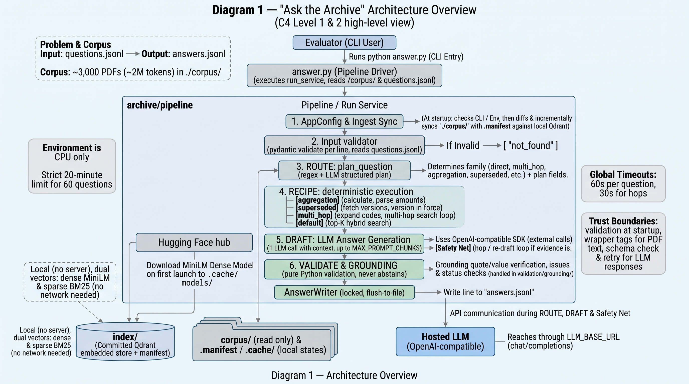

# Ask the Archive — rapport

David Pretty · `compass-challenge-david-pretty` · score sur les 20 exemples : **45,00 / 45**

## 1. Vue d'ensemble

**Problème.** 3 048 PDF fictifs de Brumeval (≈ 2 M tokens, deux fois le
contexte du modèle), en français et en anglais, avec coquilles, tableaux et
versions successives. Il faut répondre court, citer les documents, et dire
`not_found` ou `conflict` quand il le faut, en moins de 20 min pour 60
questions, sur CPU.

**Approche : Model de routage qui dirige vers des pipelines déterministes par categorie, RAG hybride et validation en Python.**

**Stack.** Python 3.11, pdfplumber (texte et tableaux), Qdrant embarqué
(index pré-construit et versionné, synchronisé au démarrage par un manifeste
taille + SHA-1 : seuls les PDF ajoutés ou modifiés sont réindexés), fastembed
(BM25 et MiniLM multilingue en ONNX, sans PyTorch), SDK `openai`, pydantic.
Aucun serveur, aucun GPU.

**Gestion des erreurs.** Variable `LLM_*` manquante, corpus ou fichier
introuvable : message explicite et code 1. API : timeouts, 429 et 5xx rejoués
avec backoff (3 tentatives, `Retry-After` respecté). Sortie mal formée :
schéma JSON, puis JSON dans le texte, puis une demande de réparation. Budgets
de 60 s par question et 17 min au total : toute question en échec reçoit une
ligne `not_found`, le fichier contient toujours une ligne par id. Modèle
dense indisponible : repli BM25 seul.

**Traçabilité et observabilité.**

- *Citations contrôlées.* Une citation n'est acceptée que si le document fait
  partie des résultats de recherche RAG de la question.
- *Réponse ancrée.* Pour chaque source, le modèle donne un extrait mot pour
  mot ; Python vérifie que l'extrait figure bien dans le document. Chaque
  valeur de la réponse (montant, date, nombre) doit se trouver dans un extrait
  vérifié ou venir d'un calcul fait en Python. Un écart ne bloque pas la
  réponse : il abaisse le niveau de confiance (élevée, moyenne, faible),
  calculé par règles fixes.
- *Une trace par question.* Un fichier JSON (`traces/<run>/`) enregistre le
  plan du routeur, les documents récupérés et leur score, le brouillon, les
  problèmes de validation, les citations écartées, le résultat de l'ancrage,
  la réponse finale et la durée de chaque étape. Le déroulement est aussi
  journalisé sur stderr.
- *Lisible sans ouvrir le JSON.* L'application de l'angle libre (section 3)
  affiche ces étapes en direct et encadre chaque preuve sur la page PDF.

## 2. Compromis et résultats

| Décision | Alternatives écartées | Pourquoi |
|---|---|---|
| Index pré-construit, Qdrant embarqué hybride | Extraction au lancement ; serveur Qdrant ou Elasticsearch | L'extraction prend ≈ 0,17 s/doc (≈ 9 min) ; installation `pip` seule exigée, donc pas de Docker |
| Aucun chunking : un document = une entrée d'index | Séparation des tableaux, et division de la partie texte selon les sections des documents | Le plus long PDF fait 644 mots : chaque document tient entier dans le prompt. Découper aurait séparé un tableau de son en-tête (montant d'une facture sans son client) et occupé plusieurs places du top-k avec le même document. La citation attendue est un `doc_id`, donc un document entier est la bonne unité |
| Routage par le même LLM (1 appel, plan structuré) | Petit modèle de classification, entraîné ou modèle de décision comme JEV | Un classifieur serait plus rapide, moins cher et stable d'un appel à l'autre. Faute de temps et de données d'entraînement (20 exemples), le LLM fourni fait aussi le routage ; des règles regex passent avant lui |
| Pas d'étape de validation de la question | Filtre d'entrée (hors sujet, question vide de sens) | Par simplicité, et à cause de l'existence du routeur qui bloque toute question absurde en `not_found` |
| Pipelines déterministes + un seul appel de brouillon | Agent ReAct à outils libres | Temps et coût prévisibles. L'agrégation liste toutes les factures et somme en décimal exact en Python ; le multi-sauts suit les codes partagés (BRV-, F-, C-) puis le champ `missing` du brouillon (≤ 3 brouillons) |
| Dense MiniLM, sur les 128 premiers tokens | e5-large (2,2 Go) ; fenêtre plus longue | MiniLM est le plus petit modèle à 0,02 du meilleur rappel (rappel@16 : 0,79 → 0,82, +0,07 sur des paraphrases). Seul le début de chaque document est vectorisé ; le document entier aurait été préférable, mais l'indexation et les requêtes sur CPU local dépassaient le budget. BM25 couvre le texte complet |
| Top-k 16 après fusion RRF, sans reranker | Reranker (jina, bge) sur les 30 meilleurs candidats | BM25 et dense renvoient chacun 50 candidats, fusionnés par RRF ; les 16 premiers documents vont au prompt. Avec 8, les agrégations perdaient des factures ; 16 garde le prompt court. Un reranker aurait aidé ici (paraphrases, questions FR sur documents EN, ordre des versions), mais il coûtait 20 à 35 s par question (jina, 11,8 Go de RAM) et 105 à 140 s (bge) sur CPU, hors du budget de 20 min |

Temps : 5,2 s par question en moyenne (max 13,8 s, 8 en parallèle) ;
démarrage à froid 20 s, téléchargement du modèle dense compris.

**Risques acceptés.** Vingt exemples seulement : les pipelines peuvent être
trop ajustées. Une question d'agrégation ou de version mal routée n'est pas
rattrapée. Le modèle dense est téléchargé au lancement (repli BM25). Le
stockage Qdrant local est lié aux versions épinglées.

## 3. Angle libre : « vérifier en un clic »

**Contexte.** Le score sur 20 exemples mesure le système, pas chaque
réponse. En usage réel, il n'y a pas de
corrigé : il faut pouvoir juger une réponse seule.

**Limites du RAG, et ce que l'application montre pour chacune.** [\[LIEN DÉMO\]](https://youtu.be/lkWiLNiX0Ww)

| Limite | Conséquence | Dans l'application |
|---|---|---|
| Une citation est un identifiant, pas une preuve | Le relecteur doit rouvrir le PDF et chercher la phrase | L'extrait est encadré sur l'image de la page PDF : vert s'il figure mot pour mot dans le document |
| Le modèle peut citer un document et prendre la valeur ailleurs | Réponse plausible, citée, mais non appuyée | Chaque valeur non retrouvée est nommée, par exemple « 0,53 $ - introuvable dans les sources » |
| Une confiance donnée par le modèle n'est pas fiable | On ne sait pas quelles réponses relire | Confiance calculée par règles, et « Pourquoi cette confiance ? » liste les règles déclenchées |
| La recherche peut manquer le bon document | Un `not_found` ne dit pas si le document existe | Les documents consultés sont listés avec leur score |
| Versions et sources contradictoires | Le relecteur ne voit qu'une valeur | Les sources en conflit sont affichées côte à côte |
| Le pipeline est une boîte noire | Impossible de savoir quelle étape a échoué | Les étapes s'affichent en direct (routage, recherche, rédaction, saut, validation, vérification), puis restent sous la réponse avec leur durée |
